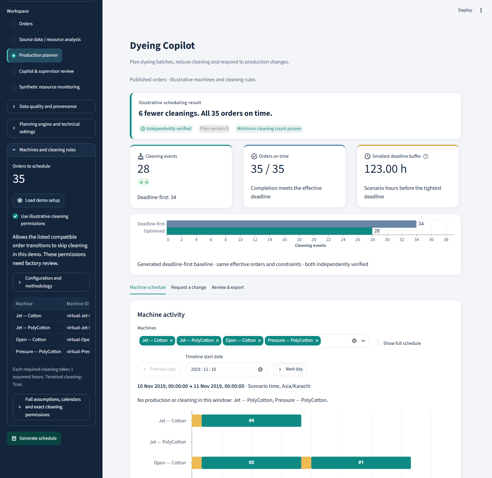
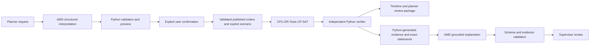

# Dyeing Copilot

An industrial planning dashboard for the AMD Developers Hackathon ACT III,
Intelligent Industry track. Schedule published dyeing orders, compare cleaning
requirements, respond to an outage or deadline change, and review a grounded
AMD explanation before exporting a planner review package.



*Existing illustrative demo: the generated deadline-first baseline uses 34 cleaning
events and the CP-SAT plan uses 28, with all 35 orders on time. This comparison
requires explicitly enabling the listed illustrative cleaning permissions. It is
a scenario result, not measured factory water, financial or realised savings.*

## What you can do

- **Production planner:** load the demo setup, review machines and cleaning rules,
  generate a verified schedule, and inspect production/cleaning on a daily timeline.
- **Request a change:** ask AMD to interpret an explicit machine outage or order
  deadline, or enter it manually. Inspect the validated preview and separately
  confirm application and rescheduling. Ambiguous dates require clarification.
- **Review & export:** explain the current verified plan with citations, save a
  supervisor review and export the exact matching evidence. Acceptance means
  **further review**, never production approval or machine control.
- **Secondary workspaces:** browse/import orders, examine recorded resource
  analysis, or replay the separate synthetic daily-resource monitoring dataset.

## Run locally

Use Python **3.11** and the pinned dependencies. In PowerShell:

```powershell
git clone https://github.com/Gulshaheer-AI/dyeing-copilot.git
cd dyeing-copilot
py -3.11 -m venv .venv
.venv/Scripts/python.exe -m pip install -r requirements.txt
.venv/Scripts/python.exe -m streamlit run streamlit_app.py
```

Open **http://localhost:8501**. There is no hosted deployment claimed here.
The trusted frozen model artifacts and permitted data are included; no training
is needed for the demo. Never load arbitrary third-party joblib artifacts.

Select **Load demo setup**, inspect the assumptions, then **Generate schedule**.
Cleaning permissions start **off**. To reproduce the pictured scenario, explicitly
select **Use illustrative cleaning permissions** and generate again. Counts and
buffers are calculated from the current verified result, not the screenshot.
Bounded solver runs can differ in timing and deadline-buffer quality.

## Configure AMD

```powershell
Copy-Item .env.example .env
```

Set `AMD_API_KEY`, `AMD_BASE_URL` and `AMD_MODEL` locally using your participant
AMD Token Factory model details and documented endpoint. No endpoint/model is
silently substituted. See [AMD setup](reports/amd_setup.md).

The repository contains placeholders only. Never commit `.env` or keys. Without
credentials, manual planning still works; explicitly select **Mock demonstration
(no API call)** for a labelled offline explanation. Mock responses are not live
AMD inference. Navigation never automatically calls AMD. Timeouts preserve the
schedule and offer retry.

## How it works



AMD interprets supported requests and explains evidence; it does not create or
silently alter schedules. CPU CP-SAT assigns compatible machines, chooses immediate
predecessors and processing times. A separate verifier checks completeness,
quantities, compatibility, capacity, calendars, deadlines and cleaning rules.

Stage A minimises cleaning events, including initial and terminal cleaning. Stage B
holds that count fixed and improves the minimum deadline buffer while protecting
the verified incumbent. Only solver-supported optimality is labelled proven.
See [scenario equations](reports/scenario_model.md) and [CP-SAT model](reports/cp_sat_model.md).

Explanations select exact Python-generated statements and supported citations.
Selected-schedule responses require `quantitative_claims: []`. Scenario/source,
backend or schedule changes invalidate stale explanations and review actions.
Tabular monitoring models are frozen CPU-trained scikit-learn models; the AMD
connection is used for interpretation/explanations, not tabular model training.

## Data, assumptions and limits

- **Published orders:** 35 distinct Sitara Faisalabad records from Elahi et al.
  (2022), [PeerJ Computer Science e932](https://doi.org/10.7717/peerj-cs.932),
  [supplement](https://doi.org/10.7717/peerj-cs.932/supp-1), CC BY per archived
  article metadata. Original values are preserved. Recorded modelled water totals
  sum to 47,950 in unresolved source units; these are not established litre readings.
- **Scheduling:** virtual machines, capacities, duration interpretation and cleaning
  permissions are illustrative. Vessel categories are not actual machine IDs.
  Colour alone cannot authorise skipping cleaning. Factory recipe/quality approval,
  approved SOPs and production validation remain outstanding.
- **Synthetic monitoring:** 731 daily thread-dyeing records from Ananya Halder,
  [Mendeley Data v1](https://doi.org/10.17632/wfwxybkpcm.1), CC BY 4.0. These are
  synthetic daily records, not measured factory telemetry or individual batches.
  Prediction residuals are investigation flags, not confirmed faults or recoverable savings.

Only the two distributable dataset folders are included. Restricted reuse experiments
are excluded. Third-party datasets, research archives and dependencies retain their
own licences; no blanket software/data licence is implied. See
[distribution and attribution](DISTRIBUTION_DATA.md), [dataset README](dyeing_dataset_pack/README.md),
[source audit](reports/source_rule_audit.md) and [model card](reports/resource_model_card.md).

## Verification and demo

```powershell
.venv/Scripts/python.exe -m unittest discover -s tests -v
.venv/Scripts/python.exe tools/verify_demo.py
```

See the [short demo walkthrough](demo_walkthrough.md) and
[industrial dashboard verification](reports/industrial_dashboard_verification.md).
The screenshot and the documented 34-to-28 comparison come from the existing demo;
no new model evaluation or factory validation is claimed by publication.

Versioned evidence and small source snapshots required by preservation regressions
remain in `reports/`, `evaluation/` and `history/`. Redundant local logs, extra
screenshots, checkpoints, ZIPs, credentials and review databases are excluded.
`PUBLIC_DISTRIBUTION.json` records the reviewed public subset; data checksums and
frozen models remain reproducible. A fresh local SQLite review database is created
when needed and stays ignored.
